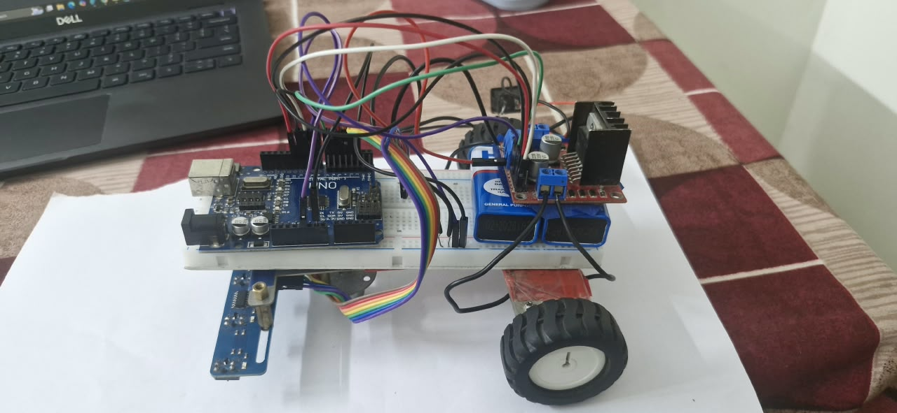
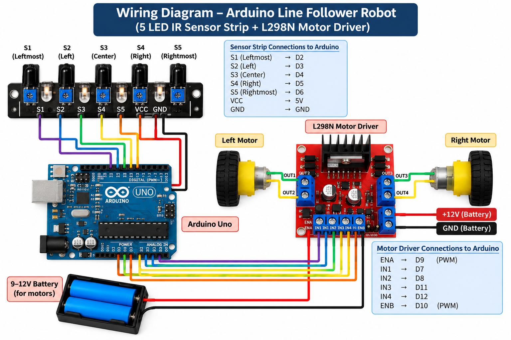

# 🤖 Arduino-Based Line Follower Robot

An Arduino-based robotics project that follows a predefined path using five digital IR sensors and an L298N motor driver. The robot reads sensor inputs and adjusts motor movement using rule-based control logic.

## 📌 Project Overview

The Line Follower Robot detects a line on a surface using an array of five digital infrared (IR) sensors. An Arduino Uno processes the sensor readings and controls two DC motors through an L298N motor driver to navigate along the path.

This project demonstrates the practical application of embedded programming, digital sensor interfacing, motor control, and hardware-software integration.

## ✨ Features

- **Five-sensor line detection:** Uses five digital IR sensors to detect the line position.
- **Arduino-based control:** Processes sensor inputs and determines the robot's movement.
- **Motor direction control:** Supports forward movement, directional turning, and stopping.
- **PWM motor control:** Uses PWM signals to regulate motor speed.
- **Serial monitoring:** Prints sensor readings to the Serial Monitor for debugging.
- **Rule-based navigation:** Uses conditional logic to determine movement from sensor states.

## 🛠️ Hardware Components

| Component | Purpose |
|---|---|
| Arduino Uno | Main controller |
| Five-channel digital IR sensor strip | Detects the line |
| L298N motor driver | Controls motor direction and speed |
| Two DC geared motors | Drive the robot |
| Robot chassis and wheels | Mechanical structure |
| Battery pack | Supplies motor power |
| Jumper wires | Electrical connections |

## 💻 Software and Technologies

- Arduino IDE
- Embedded C/C++ (Arduino programming)
- Digital GPIO interfacing
- PWM motor control
- Serial communication

## 🔌 Pin Configuration

### IR Sensor Strip

| Sensor | Position | Arduino Pin |
|---|---|---|
| S1 | Leftmost | D2 |
| S2 | Left | D3 |
| S3 | Center | D4 |
| S4 | Right | D5 |
| S5 | Rightmost | D6 |

The sensor outputs are read using `digitalRead()`.

### L298N Motor Driver

| Motor Driver Pin | Arduino Pin | Function |
|---|---|---|
| ENA | D9 | Right motor speed control |
| IN1 | D7 | Right motor direction |
| IN2 | D8 | Right motor direction |
| IN3 | D11 | Left motor direction |
| IN4 | D12 | Left motor direction |
| ENB | D10 | Left motor speed control |

The motor speeds are controlled using `analogWrite()` on the enable pins.

## ⚙️ How It Works

1. The five IR sensors continuously read the surface beneath the robot.
2. The Arduino reads the sensor states and prints them to the Serial Monitor.
3. Conditional statements determine whether the robot should move forward, turn, or stop.
4. The L298N motor driver receives control signals from the Arduino.
5. The driver controls the two DC motors to execute the selected movement.

### Movement Logic

- **Forward:** The center sensor detects the line, or specified multi-sensor patterns indicate forward movement.
- **Turning:** Left-side or right-side sensor readings trigger the corresponding motor-control function.
- **Stop:** If none of the programmed conditions match, both motors are stopped.

The implementation uses rule-based control rather than a PID control algorithm.

## 🚀 Getting Started

### 1. Install the Arduino IDE

Download and install the Arduino IDE from the official website:

https://www.arduino.cc/en/software

### 2. Connect the Hardware

Connect the Arduino Uno, five-channel IR sensor strip, L298N motor driver, DC motors, and battery according to the pin configuration above.

Ensure that the Arduino and motor driver share a common ground.

### 3. Open the Source Code

Open the project's `.ino` file in the Arduino IDE.

### 4. Configure the Board and Port

- Select **Arduino Uno** under Tools → Board.
- Select the appropriate serial port under Tools → Port.

### 5. Upload the Code

Compile and upload the program to the Arduino Uno.

### 6. Test the Robot

Place the robot over a clearly visible line on a suitable surface. Open the Serial Monitor at **9600 baud** to observe the sensor readings while testing the robot's movement.

## 🔧 Configuration

The base motor speed is defined in the source code:

```cpp
int baseSpeed = 90;
```

This value can be adjusted between 0 and 255, depending on the motor, driver, battery, and surface conditions.

The sensor logic assumes that a digital reading of `0` indicates line detection. Actual sensor polarity may vary, so verify the output of your sensor strip before operation.

## 📷 Project Images

Add photographs of your actual hardware and wiring diagram here.

Example repository structure:

```text
arduino-line-follower-robot/
├── line_follower.ino
├── README.md
└── images/
    ├── robot.jpg
    └── wiring-diagram.png
```

## 📷 Project Images

### 1. Robot Hardware

The physical prototype of the Arduino-based line follower robot.



### 2. Wiring Diagram

Illustrative wiring reference for the Arduino, five-sensor strip, L298N motor driver, and motors.




## 🔮 Possible Future Improvements

- Implement PID-based line-following control.
- Add sensor calibration and more robust line-loss recovery.
- Tune motor speeds and turning behavior for smoother navigation.
- Improve handling of intersections and sharp turns.
- Optimize power consumption and hardware integration.

## 🎯 Learning Outcomes

This project provided hands-on experience with:

- Arduino programming and embedded C/C++.
- Digital sensor interfacing.
- DC motor control using an H-bridge driver.
- PWM-based speed regulation.
- Serial debugging and hardware-software integration.
- Rule-based decision-making in a robotics application.

## 👨‍💻 Author

**Bharadwaz**

Computer Science and Engineering Undergraduate

## 📄 License

This project is available for educational and learning purposes. If you plan to reuse or distribute the code, consider adding an explicit open-source license.
